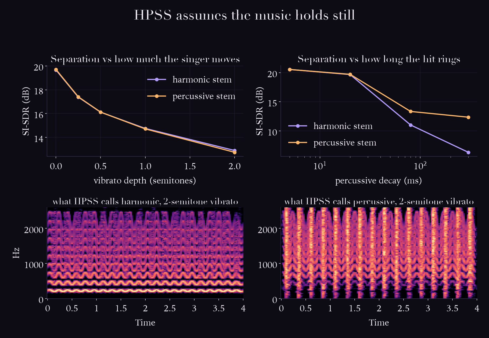
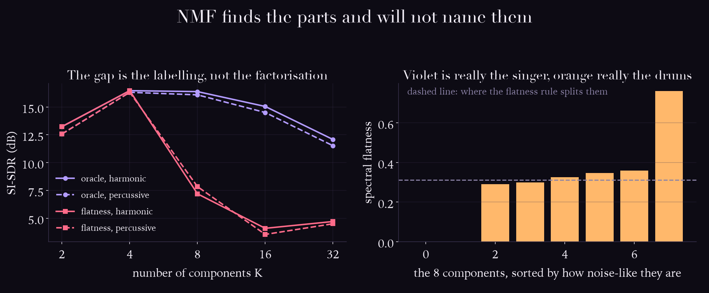
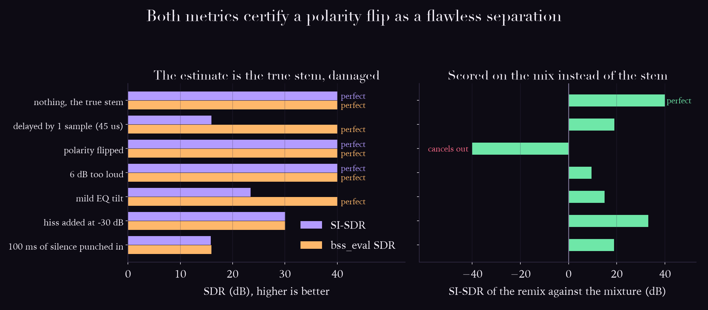

# Day 09: Source separation, the learned answer

Day 8 ended in a loop with no entry: to use harmonicity you need the f0s, and to get the
f0s you need the voices separated. The field's way out was to stop writing the rules.

This day is the two classics that do not need training data, HPSS and NMF. Both work.
Both then fail in ways that say something specific about music, and the day ends on the
thing nobody checks, which is whether the score means what it is read to mean.

Everything here is measured against sources I synthesised, so leakage and reconstruction
error can be told apart. Real music gives you a mixture and no stems, which is exactly
why the honest numbers are rare.

## The ear does this

You hear the singer apart from the band. You get one pressure wave, no stems, no second
take, and no training, and you still hear a voice in front of a drum kit.

## The machine does this

**HPSS** (Fitzgerald, 2010). In a spectrogram, held notes are horizontal lines and drum
hits are vertical lines. Median-filter along time to keep the horizontal, along frequency
to keep the vertical. No training, no model, about ten lines.

**NMF** (Lee and Seung, 1999). Factor the magnitude spectrogram into K spectral templates
and their activations over time. The templates come out looking like notes and like hits,
unsupervised.

On a mixture of a steady tone and hits that stop dead, HPSS gets **19.7 dB SI-SDR** on
both stems. It is a real method and it deserves its reputation.

## Where it breaks

### 1. HPSS is a bet that the music holds still



Horizontal and vertical are not descriptions of music, they are assumptions about it:
that the singer does not bend, and that the hit does not ring. Sweep each one.

| vibrato depth | harmonic stem | percussive stem |
|---|---|---|
| none | 19.7 dB | 19.7 dB |
| 0.25 semitones | 17.4 | 17.4 |
| 0.5 semitones | 16.1 | 16.1 |
| 1 semitone | 14.8 | 14.7 |
| 2 semitones | **12.9** | **12.8** |

A pop singer's vibrato sits around a quarter to half a semitone, and that alone costs
**3.6 dB**. Nothing is wrong with the audio. The singer is just singing, and the measure
of how much they are singing is the measure of how much leaks.

| percussive decay | harmonic stem | percussive stem |
|---|---|---|
| 5 ms, a click | 20.5 dB | 20.5 dB |
| 20 ms | 19.7 | 19.7 |
| 80 ms | 11.0 | 13.3 |
| 300 ms, a cymbal | **6.3** | 12.4 |

Note which stem that wrecks. A ringing cymbal costs the **harmonic** stem 14 dB and the
percussive stem only 8, because a long tail is a horizontal smear, so the filter labels
the ring as a held note and posts it to the singer.

So the two failures point the same way. **Vibrato is a held note behaving vertically, a
cymbal is a hit behaving horizontally, and there is no third bin.** The axes are
orthogonal and expressive music lives on the diagonal.

librosa does offer the third bin: raise `margin` above 1 and anything ambiguous goes to a
residual belonging to neither stem. On the 2-semitone mixture:

| margin | harmonic | percussive | energy kept |
|---|---|---|---|
| 1.0 | 12.9 dB | 12.8 dB | 92.0% |
| 2.0 | 10.0 | 12.8 | 82.1% |
| 4.0 | 7.3 | 10.0 | 71.3% |
| 8.0 | **5.1** | **7.8** | **56.8%** |

It does not rescue anything. Both stems get worse the more it is allowed to abstain, and
at margin 8 it has thrown away **43% of the audio**. Refusing to classify the ambiguous
energy is not the same as handling it. The vibrato really is in both stems, because it
really is both things.

### 2. NMF finds the parts and will not name them



The factorisation is not the hard part. Deciding which of the K components is the singer
is, and NMF has no opinion about it. Scored two ways: an **oracle** that peeks at the true
stems, and a **flatness** rule that calls the noise-like templates drums, which is a real
rule that works on real music.

| K | oracle h / p | flatness h / p | components that really are drums, vs what the rule says |
|---|---|---|---|
| 2 | 13.2 / 12.6 dB | 13.2 / 12.6 | 1 of 2, rule says 1 |
| 4 | **16.5 / 16.3** | **16.5 / 16.3** | 2 of 4, rule says 2 |
| 8 | 16.4 / 16.1 | 7.2 / 7.8 | 6 of 8, rule says 4 |
| 16 | 15.0 / 14.5 | 4.1 / 3.5 | **14 of 16, rule says 8** |
| 32 | 12.1 / 11.5 | 4.7 / 4.5 | 29 of 32, rule says 16 |

At K=4 the rule is perfect, and it is perfect for a stupid reason: there are two sources
and it splits at the median, so it guesses half and half is correct. At K=16 the truth is
14 and 2, the rule still says 8 and 8, and the separation loses **11 dB purely to
labelling**. The factorisation at K=16 is fine. The oracle pulls 15 dB out of exactly the
same components.

That is day 8 again in a different costume. **To assign the components you need to know
the sources, and the components are how you were going to find the sources.** NMF does not
break the loop, it relocates it.

### 3. The score says perfect while the mix is destroyed



Every paper here reports SDR, and the whole argument of the day rests on it, so it is
worth checking what it actually rewards. Hand the metric the true stem, undamaged, then
damage it one way at a time in ways describable in plain English. Over 100 dB is float
noise, printed as "perfect".

| what I did to the true stem | can you hear it | SI-SDR | bss_eval SDR |
|---|---|---|---|
| nothing | no | perfect | perfect |
| delayed by 1 sample, 45 microseconds | **no** | **15.9 dB** | perfect |
| polarity flipped | not on its own | perfect | perfect |
| made 6 dB too loud | **obviously** | **perfect** | **perfect** |
| mild EQ tilt, 5.4 dB across the band | yes | 23.4 | **perfect** |
| hiss at -30 dB | yes | 30.0 | 30.1 |
| 100 ms of silence punched in | glaringly | 15.9 | 15.9 |

Three things, in order of how much they bother me.

**SI-SDR scores a 45 microsecond delay and a 100 millisecond hole identically**, 15.9 dB
each. One is a shift no ear or microphone resolves. The other swallows a syllable.

**The two metrics disagree by more than 200 dB on the same file.** A 1-sample delay is
catastrophic to one and invisible to the other, because bss_eval permits any 512-tap FIR
filter and a delay is a filter. Which definition gets cited decides whether a system looks
broken or flawless, and both are standard.

**Both certify the polarity flip as a flawless separation.** Both are blind to a sign,
because scaling is free and -1 is a scale. But a stem is not the deliverable, the mix is.
Put each damaged stem back with the untouched one and score the remix against the original
mixture:

| | remix vs mixture |
|---|---|
| nothing | perfect |
| polarity flipped | **-200 dB** |
| 6 dB too loud | 9.5 |
| mild EQ tilt | 15.0 |
| 100 ms of silence | 18.9 |
| 1-sample delay | 19.0 |
| hiss at -30 dB | 33.0 |

The flip cancels the singer out of the record. Two standard metrics called that perfect,
and one line of arithmetic on the mix catches it. The remix column also reorders
everything else sensibly: being 6 dB loud is the worst of the real damage, and the
inaudible delay is near the bottom where it belongs.

Scale invariance and filter invariance are only free if the stem never goes back in a mix,
and the reason anyone separates a stem is to put it back in a mix.

## What day 14 has to beat

19.7 dB from ten lines of median filtering, on a mixture built to suit it. Not a hard bar
for a trained model, but a specific one, and the sweeps above are the part a learned
system should be made to answer: does it also lose 7 dB when the singer uses vibrato.

## What is not shown here

- The mixture is synthetic and two-source, which is **HPSS's best case by construction**.
  Real music has a dozen sources and a room. These dB values are not comparable to
  anything reported on MUSDB18.
- No learned baseline yet. Demucs and Open-Unmix need torch, which this environment does
  not have, so the comparison stays open.
- SI-SDR and bss_eval are the two I implemented. PEASS and the listening-test literature
  exist precisely because of section 3, and are not touched here.
- One synthetic case is not evidence that the metric fails on real music, only that its
  invariances are not the ear's. Day 16 is where claims get tested against a shuffled
  null, and section 3 is a demonstration, not a result.

## Run it

```bash
source .venv/bin/activate
python labs/day-09-separation/hpss.py
python labs/day-09-separation/nmf.py
python labs/day-09-separation/metrics.py
```

Listen before reading the table in section 3: `out/damaged_*.wav`. Rank them by ear
first, then compare the ranking against the metric's.

## Sources

- Fitzgerald, "Harmonic/Percussive Separation using Median Filtering," DAFx 2010
- Driedger, Müller, Disch, "Extending harmonic-percussive separation of audio signals,"
  ISMIR 2014 (the residual, and the `margin` parameter used above)
- Lee and Seung, "Learning the parts of objects by non-negative matrix factorization,"
  Nature 1999
- Vincent, Gribonval, Févotte, "Performance measurement in blind audio source separation,"
  IEEE TASLP 2006 (bss_eval, and the filter it allows)
- Le Roux, Wisdom, Erdogan, Hershey, "SDR: half-baked or well done?", ICASSP 2019 (SI-SDR,
  and the argument that the allowed filter inflates scores)
- Müller, *Fundamentals of Music Processing*, Chapter 8
- Namballa, Roginska, Fuentes, "Do Music Source Separation Models Preserve Spatial
  Information in Binaural Audio?", ISMIR 2025, and Namballa and Fuentes, "Spacing Out: On
  the Reliability of Binaural Music Source Separation Metrics," ISMIR 2026. The spatial
  version of section 3, and a much sharper one: interaural cues live in exactly the phase
  and filter differences these metrics are built to forgive.
